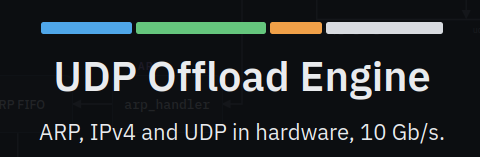

<p align="center">
  
</p>

A UDP/IPv4/Ethernet offload engine in VHDL, targeting a Xilinx FPGA behind the
XXV Ethernet (10G/25G) MAC.

## Features

- **Unpacking Ethernet, IPv4 and UDP headers**

  <table>
    <tr><td>✅ Filtering based on destination MAC address</td><td>❌️ Receive broadcast or multicast UDP</td></tr>
    <tr><td>✅ Checks the IPv4 header: version, fragmentation, protocol, checksum, destination IP</td><td>❌️ Check the UDP checksum</td></tr>
    <tr><td>✅ Drops frames the MAC flagged as bad, whole</td><td>❌️ Filter by UDP port (your logic routes by <code>udp_rx_dst_port</code>)</td></tr>
    <tr><td>✅ Reports the source MAC, IP and port, and the destination port</td><td>❌️ Handle backpressure: <code>udp_rx</code> has no <code>tready</code></td></tr>
    <tr><td>✅ Frames up to 16 KB, so jumbo frames (MTU 9000)</td><td>❌️ Reassemble fragmented IP packets</td></tr>
  </table>

- **Building Ethernet, IPv4 and UDP headers**

  <table>
    <tr><td>✅ Destination MAC, IP and port chosen per packet, even back to back</td><td>❌️ Compute the UDP checksum (always sent as 0)</td></tr>
    <tr><td>✅ IPv4 header checksum and a per-packet ID</td><td>❌️ Fragment a payload larger than the MTU</td></tr>
    <tr><td>✅ Pads short payloads to Ethernet's 60-byte minimum</td><td>❌️ Reply automatically to whoever sent a packet</td></tr>
    <tr><td>✅ Jumbo frames, measured at 9.71 Gb/s on a 10G link</td><td></td></tr>
  </table>

- **ARP**

  <table>
    <tr><td>✅ Answers ARP requests for its own IP</td><td>❌️ Send ARP requests, so it cannot find a peer's MAC by itself</td></tr>
    <tr><td>✅ Replies go out ahead of data, never mid-packet</td><td></td></tr>
  </table>

## Throughput

Measured on hardware, 10G link, loopback:

| payload | sustained | of the theoretical maximum |
|--:|--:|--:|
| 8958 (jumbo) | 9.71 Gbps | 97.5 % |
| 4096 | 9.44 Gbps | 95.4 % |
| 2048 | 8.59 Gbps | 87.6 % |

## Ports

| group | direction | notes |
|---|---|---|
| `mac_rx_*` | in | from the MAC. Carries `tuser` as the MAC's per-frame error flag |
| `mac_tx_*` | out | to the MAC, with `tready` |
| `udp_rx_*` | out | payload delivered to your logic. **No `tready`** |
| `udp_tx_*` | in | payload to transmit, with `tready` |
| `udp_rx_src_mac/src_ip/src_port/dst_port` | out | who the packet came from, and which port it was for |
| `conf_mac`, `conf_ip`, `conf_port` | in | this node's own address |
| `conf_tx_dst_mac/dst_ip/dst_port` | in | where transmitted packets go |

## What is where

| Folder | What it holds |
|---|---|
| `rtl/` | the hardware design -- one VHDL file per block |
| `testbenches/` | VHDL testbenches and the reusable AXIS components they are built from ([README](testbenches/README.md)) |
| `reference_model/` | an independent Python model of the same protocols; writes the test vectors and compares the results |
| `scripts/` | build and run helpers, and the Vivado scripts that package the UOE and add it to a block design |
| `host_test/` | host-side bring-up test for the real board ([README](host_test/README.md)) |
| `Docs/` | [integration](Docs/integration.md), and the images used here |


## Getting started

1. **Package the UOE as a Vivado IP**, for your FPGA part:

   ```bash
   ./scripts/package_uoe.sh --part xczu9eg-ffvb1156-2-e
   ```

   `--part` is the FPGA part of the project the IP is for: Vivado shows it
   under Project Settings > General > Project device, and the example is the
   ZCU102's. Any part Vivado accepts works.

   The IP lands in `ip/uoe` (`--out` to change that). Add `ip/` to your project's IP repositories
   (Settings > IP > Repository) and it is in the catalog as
   "UDP Offload Engine".

2. **Or add it to a block design, wired to an XXV 10G MAC.** With the
   project closed in Vivado (this packages the IP itself):

   ```bash
   ./scripts/add_uoe.sh --project my_project.xpr --ip 192.168.1.128 \
       --dclk zynq_ultra_ps_e_0/pl_clk0 --resetn zynq_ultra_ps_e_0/pl_resetn0 --sfp 0
   ```

   | option | what it is |
   |---|---|
   | `--project` | the Vivado project (`.xpr`) whose block design gets the UOE |
   | `--ip` | the board's own IPv4 address on the network (the UOE's `conf_ip`) |
   | `--dclk` | a free-running clock already in the block design, e.g. 100 MHz from the PS. It clocks the MAC's transceiver control and its register port |
   | `--resetn` | an active-low reset for that clock; it also holds the MAC in reset |
   | `--sfp` | ZCU102 only: which SFP+ cage (0..3) the cable is in. Sets the transceiver and writes the pin constraints |

   `--dclk` and `--resetn` name a pin as `<block>/<pin>`, as the block
   design shows it. Useful optional ones: `--mac` (the board's MAC, default
   00:0A:35:00:00:01), `--port` (the UDP port it sends from, default 1234) and
   `--axi` (an AXI master, e.g. `zynq_ultra_ps_e_0/M_AXI_HPM0_FPD`, to reach
   the MAC's registers). On other boards use `--gt_quad`/`--gt_lane` instead of
   `--sfp`. Then connect your logic to `udp_rx`/`udp_tx` and `conf_tx_dst_*`. The options,
   and what is left for you, are in
   [Docs/integration.md](Docs/integration.md#using-it-in-a-block-design).

## Testing

How the tests work and how to run them is in
[testbenches/README.md](testbenches/README.md).

## License

MIT, see [LICENSE](LICENSE).
